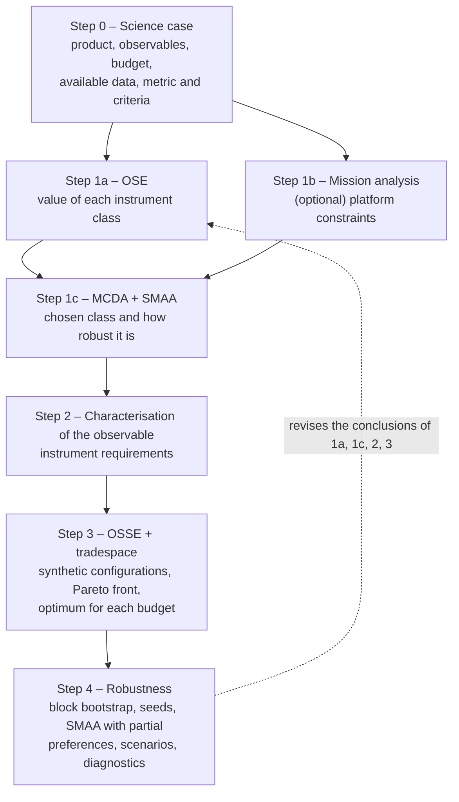

# The Catalog-to-Configuration (C2C) framework: known-answer validation

This repository contains the code and the results of the validation of **C2C**, a data-driven method for choosing and designing a scientific instrument. C2C starts from the data that already exist (a catalog of past observations, a physical model, or both) and answers four questions with the same data and the same metric:

1. **Which class of instrument** carries the most useful information? (Step 1)
2. **What must it be able to do?** (Step 2, requirements)
3. **Which configuration** gives the best performance for each budget? (Step 3)
4. **How robust** are these answers? (Step 4)

The name summarises the path: **from the catalog to the configuration**. None of the single methods is new; what C2C adds is their integration into one reproducible chain, in which every step uses the same data and the same metric, and every answer comes with a statement of how far it can be trusted.

C2C does not depend on the kind of instrument, platform or product. It needs a quantitative metric for the product, data (a catalog, a model, or both) and a model of the instrument that turns the truth into synthetic measurements. The validation in this repository uses an event forecast because it is the hardest case for the statistics: consecutive units are dependent, critical cases are rare, and the metric depends on a threshold.

> **Paper.** The method and this validation are described in: *From catalog to configuration: a data-driven framework for selecting and designing space instruments* (in preparation). Please cite the paper, and this repository, if you use the code.

**Results of the validation, one line per step**

1. **Step 1a.** The physical and the statistical analysis chains give the same ranking of the instrument classes when the model is correct and the catalog is long. The Kalman filter is sensitive to timing errors in the model, not to amplitude errors; the statistical chain still works with short catalogs (500 steps, about 6 episodes). When two classes are worth almost the same, the standard rule always names a winner and is wrong up to 43% of the time without knowing it; C2C names a winner only when the data support it, and then it is almost always right.
2. **Step 1c.** A multi-criteria decision analysis (MCDA) with one weight vector gives a winner but does not say how robust it is; SMAA does (A is first for 90–93% of all possible weights). With two classes of similar value, the MCDA picks the wrong class up to 87% of the time; in those cases SMAA almost always answers that no class is the best for nearly all weights.
3. **Step 2.** The requirements derived from the episodes of the catalog are all safe, and the latency can be derived *only* from the catalog. Both methods oversize the dynamic range by about a factor of 4.
4. **Step 3.** Simulated truths with a model error select almost the right configuration, but get the **performance** wrong by up to about ±0.08 of TSS, more than the difference between one budget and the next. With the observed truth (the catalog) the performance is right.
5. **Step 4.** With events that come in episodes, the bootstrap of independent steps underestimates the uncertainty by more than half; the block bootstrap recovers 80–90% of it. The optimum of a single catalog is the true one only 20–60% of the time; C2C replaces it with a **set of equivalent configurations**.

All figures are produced by the code in `src/` and saved in `results/`. References (Author year) are listed in [References](#references).

---

## Contents

**Part I – The method**
1. [Architecture](#1-architecture)
2. [The steps](#2-the-steps)
3. [Choosing the variants: analysis chain and truth](#3-choosing-the-variants-analysis-chain-and-truth)

**Part II – The method applied to a known-answer world**

4. [Why a synthetic world](#4-why-a-synthetic-world)
5. [Step 0 – Science case and metric](#5-step-0--science-case-and-metric)
6. [The two analysis chains](#6-the-two-analysis-chains)
7. [Step 1a – Which class is worth most?](#7-step-1a--which-class-is-worth-most)
8. [Step 1c – How much does the choice depend on the weights?](#8-step-1c--how-much-does-the-choice-depend-on-the-weights)
   - [Low contrast: two classes of similar value](#low-contrast-two-classes-of-similar-value)
9. [Step 2 – Requirements](#9-step-2--requirements)
10. [Step 3 – OSSE and Pareto front](#10-step-3--osse-and-pareto-front)
11. [Step 4 – Robustness to the finite catalog](#11-step-4--robustness-to-the-finite-catalog)
12. [What the validation shows](#12-what-the-validation-shows)
13. [Known limitations](#13-known-limitations)

**Part III – Reproducibility**

14. [How to rerun everything](#14-how-to-rerun-everything)
15. [Files](#15-files)
16. [Code names and paper notation](#16-code-names-and-paper-notation)
17. [References](#references)

---

# Part I – The method

## 1. Architecture



| Step | Question | Input | Output |
|---|---|---|---|
| 0 | what do we want to obtain, with which data and resources? | the science case | metric, criteria, candidate classes, budget, data |
| 1a | how much is each instrument class worth? | data + metric | for each class: content (class alone), unique contribution (class removed from the system), redundancy; for each pair of classes, whether the difference is supported by the data |
| 1b | (optional) what does the platform allow? | orbit, resources, accommodation | additional criteria and constraints |
| 1c | which class to choose, and how robust is the choice? | criteria from 1a and 1b | ranking and probability of each rank (SMAA) |
| 2 | what must the instrument be able to do? | catalog (and/or model) | requirements: sampling interval, latency, dynamic range, sensitivity, channels |
| 3 | which configuration performs best for each budget? | requirements + instrument model + truth | Pareto front, optimum for each budget, expected performance |
| 4 | how robust are the conclusions? | results of 1a–3 | uncertainties, sets of equivalent configurations, scenarios |

---

## 2. The steps

For each step: **goal**, **procedure**, **output**, the **standard variant** in the literature and the **C2C variant**, with the main references.

### Step 0 – Science case and metric

**Goal.** Fix everything the following steps take for granted. A wrong metric makes all the other steps useless.

**Procedure.** One states:
- the **product** and its **use** (for example, an alert of an event with a given lead time, or a stellar parameter with a given accuracy);
- the **observables** and the **candidate instrument classes**;
- the **budget** (mass, power, volume, cost, telemetry) and which mission choices are fixed and which are still open;
- the **available data**: a catalog of observations, a physical model, or both. Which data exist decides which variants can be used in Steps 1a and 3 ([§3](#3-choosing-the-variants-analysis-chain-and-truth));
- the **metric** used to judge an instrument, and any additional **criteria** for Step 1c.

**The metric.** For alerts of rare events a common choice is the **TSS** (True Skill Statistic, or Hanssen–Kuipers discriminant): the fraction of events that are forecast minus the fraction of false alarms (Hanssen & Kuipers 1965; Woodcock 1976). It does not reward a forecast that always says "no event" and does not depend on the event rate, which makes it the recommended choice for rare events (Bloomfield et al. 2012).

**Output.** Metric, criteria, candidate classes, budget, data.

### Step 1a – Value of the instrument classes (OSE)

**Goal.** Measure how much information useful for the metric each instrument class carries.

**Procedure.** An **OSE** (Observing System Experiment, or data denial experiment) measures the value of an instrument class by comparing estimates made with and without its data. For each class X:
- **X alone**: the estimate uses only the data of X. Its score is the **content** of X.
- **X removed from the full system**: the estimate is made with all classes, then with all classes except X. The loss of score is the **unique contribution** of X, i.e. the information that only X carries.
- The difference between content and unique contribution is the **redundancy** of X: the information that X shares with the other classes, which is not lost when X is removed.

An **analysis chain** produces the estimates. It comes in two interchangeable variants:
- **physical**: a physical model combined with the measurements by data assimilation (for example a Kalman filter; Kalman 1960). This is the classical OSE of meteorology (Bouttier & Kelly 2001; Gelaro & Zhu 2009; Samrat et al. 2025) and, in space physics, of the ionosphere and the radiation belts (Durazo et al. 2017; Shprits et al. 2025);
- **statistical**: a classifier or regressor trained on the catalog (for example gradient boosting; Friedman 2001). In each experiment it is retrained using as inputs only the catalog columns measured by the classes included. This corresponds to the importance of **groups** of variables in machine learning (Gregorutti et al. 2015; Au et al. 2022), and is close to how data sources are compared in solar energetic particle forecasting (Hosseinzadeh et al. 2025).

**Output.** The value of each class, for the metric of Step 0 and for any other criterion; for each pair of classes, whether the difference between them is supported by the data.

**Standard and C2C.** The standard is a single chain, usually the physical one, and the class with the highest value always wins. In C2C:
- the chain follows from the available data, and when both a model and a catalog exist **both** chains are run: if they give the same ranking the conclusion is robust; if not, the disagreement signals a model error or a catalog that is too short;
- for each pair of classes C2C checks whether the difference is supported by the data. The paired block bootstrap of Step 4 builds many resampled catalogs, and counts in how many of them one class beats the other. If it does so in at least 90% of them it is the better class; otherwise the two classes are declared **indistinguishable** with the available catalog ([§8](#low-contrast-two-classes-of-similar-value)).

### Step 1b – Mission analysis (optional)

**Goal.** Turn the constraints of the mission into criteria: field of view and pointing, radiation environment and shielding, available resources, telemetry windows and delivery of the data to the user.

**When it is needed.** Step 1b can be skipped when the mission accommodates all candidate classes in the same way. Its outputs enter Step 1c as criteria.

### Step 1c – Choice of the class: MCDA + SMAA

**Goal.** Combine the criteria (value from Step 1a, constraints from Step 1b) and state **which class to choose and how robust the choice is**.

**Procedure.**
- **Standard (MCDA)**: a weighted sum of the criteria with fixed weights, for example from the analytic hierarchy process (AHP; Saaty 1990). The weighted sum gives a winner, but does not say how much the winner depends on the chosen weights.
- **C2C (SMAA)**: thousands of weight vectors are drawn at random, uniformly on the simplex (a Dirichlet distribution), and for each class one computes the fraction of weights that rank it first, second, third: the **rank acceptability index** (Lahdelma et al. 1998; Lahdelma & Salminen 2001; Tervonen & Figueira 2007). The criteria can be uncertain too, for example because they are measured on a finite catalog: SMAA then takes the criteria from the bootstrap replicates, together with the random weights, and the result accounts for both uncertainties (Lahdelma & Salminen 2001).

**Output.** The chosen class, with the probability of each rank.

### Step 2 – Characterisation of the observable → requirements

**Goal.** A **requirement** is a minimum performance that the instrument must have so that the metric does not degrade, for example "at least one measurement every 5 minutes" (sampling interval), "data available within 10 minutes" (latency), "no saturation below a given flux" (dynamic range). Step 2 derives the requirements of the class chosen in Step 1c **from the data alone**, before any configuration is simulated. It gives a first reference design and decides which values to explore in Step 3.

**Procedure.** For each requirement one identifies the property of the data it depends on (for the sampling interval, how fast the signal changes) and computes its statistics, in one of two ways.

- **Standard (climatology)**: statistics of the **whole** record measured by the chosen class, without distinguishing periods with and without events. For example:
  - **sampling interval**: short enough to follow the typical variations of the signal, i.e. a fraction of its correlation time;
  - **dynamic range**: the saturation level is above almost all observed values (for example above the 99.9th percentile);
  - **latency**: cannot be derived, because the record taken as a whole does not say how long before the event the data are needed.

  This is the classical use of event statistics for environment models (Feynman & Gabriel 1990; Xapsos et al. 1998; Jiggens et al. 2012) and for instrument specification (Dichter et al. 2015).
- **C2C (critical cases of the catalog)**: statistics of the units in which the metric is decided. For an event forecast these are the **episodes**: an event of the catalog together with the period that precedes it. The **precursor** is the signal, measured by the chosen class, that anticipates the event (in the toy world, the source seen by A). In each episode a few quantities are measured, and each one sets a requirement:

  | Quantity measured in each episode | Requirement |
  |---|---|
  | **lead time**: from the precursor peak to the event onset | **latency**: the data must arrive before the event starts |
  | **rise time** of the precursor | **sampling interval**: at least two measurements during the rise |
  | **peak** of the precursor | **dynamic range**: no saturation below the peak |
  | **flux at the event threshold** | **sensitivity**: enough counts at that flux to separate the event from the noise |
  | **variety of spectra** | energy **channels** |

  Episodes differ: some rise fast, others have little lead time. Each requirement is therefore set to serve a **chosen fraction of the episodes**, for example 90%:
  - the **sampling interval** from the rise time exceeded by 90% of the episodes, so that 90% of the episodes rise more slowly and are well sampled;
  - the **latency**, likewise, from the lead time exceeded by 90% of the episodes;
  - the **dynamic range** from the peak exceeded by only 10% of the episodes.

  The 10% most extreme episodes are given up in exchange for a cheaper instrument. Characteristic times of solar energetic particle events (lead, rise) are measured, for example, by Kahler (2005, 2013).

**Output.** A list of requirements, each with the fraction of episodes it serves. They are a **starting point**: Step 3 tests them by simulating the instrument, and may find that a requirement is too strict (it can be relaxed without losing metric) or too weak (it must be tightened).

### Step 3 – OSSE + tradespace

**Goal.** Find the configuration of the instrument that performs best for each budget.

**Procedure.**
1. Define the **design variables**, i.e. the properties the designer can choose (for example collecting area, integration time, dynamic range, channels). They are not the requirements of Step 2: the requirements decide **which values to explore**, with a grid that contains them and extends beyond them, so that Step 3 can confirm, relax or tighten them. Then define an **instrument model** that, for a given configuration, produces synthetic measurements from a truth (noise, integration, saturation, delay).
2. Define a **cost model** for each resource.
3. Choose the **truth** on which the measurements are simulated ([§3](#3-choosing-the-variants-analysis-chain-and-truth)):
   - **observed**: the series of the catalog;
   - **simulated**: a *nature run*, i.e. a series generated by a physical model. Two caveats. (i) With a physical chain, its model must not be the one that generated the nature run: otherwise the chain knows exactly the laws of the "truth", the model errors with respect to the real world are both in the truth and in the estimate and disappear, and the performance is too optimistic (the "identical twin", [§3](#3-choosing-the-variants-analysis-chain-and-truth)). (ii) Even with a statistical chain, the errors of the model that generates the nature run pass to the absolute performance (Step 3 of the validation shows it, [§10](#10-step-3--osse-and-pareto-front)). For both reasons, when a catalog exists the observed truth is preferred;
   - **hybrid**: the catalog where it exists, the model (validated on the catalog) for what the catalog does not resolve.
4. For each configuration, simulate the measurements, produce the estimates with the chain of Step 1a and compute the metric.
5. Build the **Pareto front** (the configurations that no other beats at equal or lower cost) and choose the optimum for each budget.

This is an **OSSE** (Observing System Simulation Experiment; Arnold & Dey 1986; Errico et al. 2013; Hoffman & Atlas 2016; Zeng et al. 2020) inside a **tradespace exploration** (MATE; Ross et al. 2004). In the Earth and space sciences OSSEs are used mostly to decide **where** and **how many** instruments to deploy (Cucurull & Mueller 2019; Dietrich et al. 2024; Shprits et al. 2025); here they are used to decide **how** to design one.

**Standard and C2C.** The standard is a simulated truth. The guidelines ask to validate the nature run and to avoid "incestuous" experiments, with truth and analysis model too similar (Privé & Errico 2016). The default of C2C, when a catalog exists, is the observed truth.

**Output.** Pareto front, optimum for each budget, expected performance.

### Step 4 – Robustness

**Goal.** State how robust the conclusions of Steps 1a–3 are, given that the catalog is a **finite sample** and that many choices are arbitrary.

**Procedure.** Five tools, used as needed:
1. **Block bootstrap** of the catalog (Künsch 1989; Politis & Romano 1992, 1994; Lahiri 2003). The **bootstrap** estimates how much the metric would change with another catalog of the same population: many resampled catalogs are built by drawing pieces of the real catalog at random, with replacement; the metric is computed on each; the spread of the results is the uncertainty.
   The delicate point is the size of the pieces. An event does not occupy a single step: it lasts several consecutive steps, and the alert that precedes it is active for several more. These steps are not independent pieces of information, because they describe the same episode. If single steps are drawn, the bootstrap treats them as independent: it believes it has as many pieces of information as event steps, instead of episodes, and underestimates the uncertainty. If **blocks** of consecutive steps longer than an episode are drawn, each episode stays whole and the uncertainty is right again.
   If the same resampled catalogs are used for all configurations (**paired** bootstrap), one also obtains the **probability that each configuration is the optimum**, i.e. the fraction of resampled catalogs in which it is the best. From it follows the **set of equivalent configurations**: the smallest group of configurations whose probabilities add up to at least 90%.
2. **Monte Carlo seeds**: repeat the stochastic parts (noise of the synthetic instruments, training) with different random generators.
3. **SMAA with partial preferences**: repeat Step 1c with what is known about the weights, even without their exact values, for example "the forecast matters more than the nowcast" or "the cost weighs between 20% and 40%". SMAA then draws only the weight vectors that satisfy these constraints.
4. **Scenarios**: alternative truths (several nature runs, different models, subsets of the catalog), to see whether the choice changes.
5. **Diagnostics**: tests that the chain works as intended (calibration of the probabilities, comparison between the two chains, resolution of the data).

For event catalogs, the sensitivity to the number of available events is a known problem also in environment models (Rosenqvist & Hilgers 2003).

**Output.** Uncertainties, sets of equivalent configurations, stable and fragile conclusions.

---

## 3. Choosing the variants: analysis chain and truth

In Steps 1a and 3 there are two **independent** choices:
- the **analysis chain** that produces the estimates (physical or statistical);
- the **truth** on which the metric is computed (observed or simulated).

| | Statistical chain | Physical chain |
|---|---|---|
| **Observed truth (catalog)** | C2C default when a catalog exists | possible, with a model of the real system |
| **Simulated truth (nature run)** | OSSE without a catalog; the model error is only in the truth and shifts the absolute performance | "identical twin" if the filter uses the same model as the nature run: to be avoided |

**The truth** decides whether the absolute performance is right; the chain matters less. Steps 3 and 4 of the validation show it: Step 3 for the weight of the truth, Step 4 for the chain (with the same truth, Kalman filter and gradient boosting give almost the same results). The **identical twin** is the worst case because the same model error is both in the truth and in the estimate: the chain seems to know the world perfectly, the error disappears and the performance is too optimistic. For this reason meteorology uses the "fraternal twin", i.e. a different model for the assimilation (Privé & Errico 2016).

**Rules.**

| Available data | Step 1a (chain) | Step 3 (truth and chain) | What can be concluded |
|---|---|---|---|
| catalog only | statistical | observed truth, statistical chain | ranking and absolute performance, for the conditions present in the catalog |
| physical model only | physical | several nature runs, statistical chain or physical chain with a different model; validate the nature runs on every available observation | ranking of the configurations; absolute performance only as a range across scenarios |
| catalog + model | both, compared | observed truth, or hybrid for what the catalog does not resolve; both chains | everything; the comparison between the chains is an additional diagnostic |

In every case Step 4 uses blocks, and the final choice is presented as a set of equivalent configurations.

---

# Part II – The method applied to a known-answer world

## 4. Why a synthetic world

In a real case the right answer is unknown: we do not know how much an instrument is really worth, nor which of its configurations is really the best. We can only compare methods with each other.

In a synthetic world **the truth is known by construction**. For each step we can therefore ask: *does the method recover the right answer? Under which conditions does it stop doing so?* And we can generate many independent worlds, i.e. many different catalogs of the same world, to measure how much the results change from one catalog to another (Step 4).

The world is deliberately simple: it isolates the mechanisms each step must handle, it does not imitate a specific physical system. The goal is not to show that C2C "wins", but that it is **valid and reliable**, and to find **where it stops being so**.

### The steps in brief

| Step | Question | Standard | C2C | Result | Script |
|---|---|---|---|---|---|
| 0 | metric and data | — | — | TSS of the alert "event in the next 6 steps"; catalog and physical model | `world.py` |
| 1a | which class is worth most? | one chain (Kalman filter) | both chains, compared | same ranking; the filter suffers from model errors, the statistical chain from very short catalogs | `run_1a.py` |
| 1b | platform constraints | — | — | not applicable: generic classes, no platform | — |
| 1c | does the ranking depend on the weights? | MCDA with one weight vector | SMAA (random weights) | A first for 90–93% of the weights | `run_1c.py` |
| 1a + 1c | and if two classes are worth almost the same? | always a winner (largest loss; MCDA) | a winner only if supported by the data (paired bootstrap); SMAA with uncertain criteria | the standard is wrong up to 43% (1a) and 87% (1c) without knowing it; C2C, when it names a winner, is almost always right | `run_1d.py` |
| 2 | which requirements? | climatological statistics | statistics of the episodes in the catalog | catalog requirements all safe; latency only from the catalog | `run_2.py` |
| 3 | which configuration, for each budget? | OSSE on nature runs | OSSE on the observed truth | almost the same configuration; right performance only with the catalog | `run_3.py` |
| 4 | how robust is all this? | bootstrap of independent steps; single optimum | block bootstrap; set of equivalent configurations | 80–90% of the uncertainty recovered; single optimum fragile | `run_4.py` |

---

## 5. Step 0 – Science case and metric

📄 `src/world.py`

**The world.** Three ingredients, following the chain cause → environment → event:

- a **source** `d`, which varies in time with some memory:
  d[t+1] = 0.8 · d[t] + noise
- an **environment** `x`, with its own memory, which responds to the source **with a delay** L = 6 steps:
  x[t+1] = 0.7 · x[t] + 0.5 · d[t−6] + 0.5 · noise
- an **event** when `x` exceeds the threshold θ (its 97th percentile).

**Product and metric.** The alert is y = "is there at least one event in the next H = 6 steps?". The metric is the **TSS** of this alert: for every probability threshold, the fraction of events forecast (hit rate) minus the fraction of false alarms (false alarm rate), maximised over all thresholds (1 = perfect forecast, 0 = no skill). In the code it is `tss_max` in `ose_assim.py` (it lives there for historical reasons, but all chains use it).

**Candidate instrument classes.** Three generic instruments:

| Instrument | Measures | Noise (relative to the variability of the signal) | Role |
|---|---|---|---|
| A | the source `d` | 0.5 | sees the cause in advance: best to **forecast** |
| B | the environment `x` | 0.5 | sees the effect when it is already there: best to say **what is happening now** |
| C | the environment `x` | 2.0 | as B, but much noisier |

The noise is **relative** to the variability of what the instrument sees (0.5 means "half the standard deviation of the signal"), so the comparison between A and B does not depend on the units of `d` and `x`.

**Criteria for Step 1c.** Two, both measured in the world: the TSS of the **forecast** (event in the next 6 steps) and the TSS of the **nowcast** (event now).

**Platform and budget.** The classes are generic, so there is no platform and Step 1b does not apply. The budget enters in Step 3, with a cost model in arbitrary units.

**Available data.** Both a **catalog** (the simulated world, 100,000 steps, half for training and half for evaluation) and a **physical model** (the equations of the world). By the rules of [§3](#3-choosing-the-variants-analysis-chain-and-truth) both chains can therefore be used.

📊 [`results/world_check.pdf`](results/world_check.pdf)

**How to read the figure.** Top: a stretch of 500 steps with the source `d`, the environment `x`, the threshold θ (dashed) and the event steps (red dots). Middle: the labels, "event now" and, shifted up by 1.1, y = "event in the next 6 steps"; y switches on before the event, and it is this lead that A must make predictable. Bottom: correlation between the measurement of A now and the environment k steps later; the dashed line is the delay L. A is correlated with the *future* environment, so it carries information useful to the forecast.

The correlation peaks at k ≈ 8, not at L = 6, for two reasons: the source enters the environment one step later (d[t−6] acts on x[t+1]), and the environment accumulates the effect of the source for a few steps, through its memory (0.7). The peak is **not** used to fix a single delay. The chains use all the information: the filter knows the equations of the world, and the classifier receives the measurements of the last 12 steps and learns which delays matter. The alert covers a window of 6 steps, not an instant. The figure only checks that A carries information on the future.

---

## 6. The two analysis chains

**Physical chain** (📄 `src/ose_assim.py`; called *assimilative OSE* in the code and in the figures). A **Kalman filter** estimates at every step the **state** of the world, s = [x, d, d−1, …, d−L]: the environment, the source and its last L values, needed because the environment responds to the source with a delay. The filter knows the equations of the world and alternates them with the measurements, in two phases at each step t:

$$
\begin{aligned}
\text{prediction:}\quad & \hat s_t^- = F\,\hat s_{t-1}, & P_t^- &= F\,P_{t-1}\,F^\top + Q \\
\text{update:}\quad & K_t = P_t^- H^\top \left(H P_t^- H^\top + R\right)^{-1}, & \hat s_t &= \hat s_t^- + K_t\left(z_t - H\,\hat s_t^-\right), \qquad P_t = \left(I - K_t H\right) P_t^-
\end{aligned}
$$

- F: the equations of the world written as a matrix (how the state goes from one step to the next); Q: the noise that the world adds at each step;
- z: the measurements; H: which part of the state each instrument sees (A sees d, B and C see x); R: the noise of the instruments;
- ŝ and P: the estimate of the state and its uncertainty; the superscript ⁻ marks the estimate before the measurement of the step is used;
- K (Kalman gain): how much to trust the measurement with respect to the prediction. A noisy instrument (large R) gives a small K and the estimate moves little; an uncertain prediction (large P) gives a large K and the estimate follows the measurement.

In words: the filter predicts where the world should be, looks at the measurements, and corrects the prediction in proportion to how reliable the measurements are.

For the event probability the filter simulates 1000 possible futures from the estimated state and counts in how many `x` exceeds the threshold. When an exceedance is rare, a plain count would almost always give 0, and many steps would be tied although their risk is very different. The futures are therefore shifted towards the threshold, so that many of them exceed it, and each exceedance is counted with a weight that compensates the shift (**importance sampling**; Kahn & Marshall 1953). The estimate stays unbiased, and its relative error is about the same (10–30%) for probabilities of 10⁻² and of 10⁻⁵.
- Pro: it needs no catalog to learn from; it uses the physics.
- Con: if the model is wrong, the value of the instruments is wrong too.

For Step 4 the filter can also "see" the synthetic configurations of Step 3 (`assim_forecast_instrument`): it updates the state only when a new average over k steps arrives, and knows the noise of the configuration. When the instrument saturates, the measurement is not the true value but only the saturation level: the filter uses it as the information "the true value is at least the saturation level". A measurement of this kind is called **censored**, and the variant of the Kalman filter that handles it is the *Tobit Kalman filter* (Allik et al. 2016).

**Statistical chain** (📄 `src/ose_stat.py`; *statistical OSE* in the code and in the figures). A classifier learns from the catalog the relation between the measurements of the last 12 steps and the event: logistic regression or gradient boosting (Friedman 2001), as implemented in scikit-learn (Pedregosa et al. 2011). It is trained on the first half of the world and evaluated on the second.
- Pro: it needs no physical model.
- Con: it needs a long enough catalog.

The two chains are **interchangeable**: the data denial procedure (📄 `src/ose.py`: estimate with all instruments, with all but X, with X alone) is the same for both; only the chain that produces the estimates changes.

---

## 7. Step 1a – Which class is worth most?

📄 `src/run_1a.py` → [`results/run_1a.pdf`](results/run_1a.pdf), `results/run_1a_summary.csv`

**What we did.** On 10 independent worlds we computed the value of A, B and C as **unique contribution**: the **loss** of TSS when the instrument is removed from the full system (for A, from A+B+C to B+C). The reference true value is the one computed by the Kalman filter with the correct model. We then degraded each chain:
- for the physical chain, **model errors**: wrong delay (L = 5, 4, 3 instead of 6) or wrong source effect (β = 0.4, 0.3, 0.2 instead of 0.5);
- for the statistical chain, **shorter catalogs**: from 50,000 down to 500 training steps.

**Results.**

| Chain | Condition | Worlds in which the chain finds the true best class | Value of A measured by the chain / true value |
|---|---|---|---|
| Kalman | correct model | 10/10 | 1.00 |
| Kalman | delay L = 5 / 4 / 3 | 10/10 | 0.93 / 0.75 / 0.48 |
| Kalman | amplitude β = 0.4 / 0.3 / 0.2 | 10/10 | 1.00 / 0.99 / 0.97 |
| Logistic | 50,000 → 500 steps | 10/10 always | 0.85–0.93 |
| Boosting | 50,000 → 500 steps | 10/10 always | 1.00–1.16 |

**What they mean.**
- With the correct model and a long catalog **the chains are equivalent**: same ranking (A ≫ B > C), almost the same losses.
- The value of an instrument **depends on the product**: to forecast an event A ≫ B; to say whether there is an event now B > A (see Step 1c).
- **Content, unique contribution and redundancy are different things.** In the world used for Step 1c (forecast TSS, Kalman filter / boosting; with all instruments 0.84 / 0.84):

  | Instrument | Content (X alone) | Unique contribution (all − all but X) | Redundancy (content − unique contribution) |
  |---|---|---|---|
  | A | 0.83 / 0.82 | 0.30 / 0.30 | 0.53 / 0.52 |
  | B | 0.54 / 0.53 | 0.01 / 0.01 | 0.53 / 0.52 |
  | C | 0.37 / 0.36 | 0.00 / 0.00 | 0.37 / 0.35 |

  Redundancy is the part of the content of X that the other instruments can replace. B alone is worth 0.54, but next to A it adds almost nothing: almost everything B knows (the environment now) can be inferred from the source seen by A. A is partly redundant too: without A, B and C still give 0.54, because the environment has memory and an approaching event is already visible in a rising environment. But A also carries 0.30 of information that no other instrument has: it sees the cause before it reaches the environment.
  **Which quantity to use depends on the question**: to choose a single instrument, the content matters; to add one to an existing system (for example instruments already in orbit), the unique contribution matters. Redundancy is a difference of TSS, which does not add up like a physical quantity: it is an indication, not an exact measure.
- **Amplitude error** (β): the filter still finds the right ranking and almost all of the value of A, even with a source effect underestimated by a factor 2.5 (β = 0.2); its event probabilities, however, are not calibrated. The TSS depends only on the ordering of the steps, not on the values of the probabilities, so it is not affected.
- **Timing error** (L): the filter underestimates A, down to less than half of its value. The ranking survives only because A dominates.
- **Statistical chain**: it finds the best instrument in all worlds even with 500 steps (about 6 episodes). Logistic regression sees about 85% of the value of A (it is too simple a model); boosting sees all of it, or overestimates it slightly with short catalogs.
- Here A is worth about 30 times B, so finding the best class is easy. The case of two classes of similar value is treated in [§8](#low-contrast-two-classes-of-similar-value).

**How to read the figure.** Left column: physical chain, with the model error growing to the right (triangles = delay error, crosses = amplitude error; blue palette). Right column: statistical chain, with the catalog shrinking to the right (diamonds = logistic, X = boosting; warm colours). Top: fraction of worlds in which the best instrument is the true one; the dashed horizontal lines mark "reliable" (≥ 95%) and "uncertain" (80–95%). Bottom: value of A measured by the chain divided by the true value (1 = exact; below 1 underestimated, above 1 overestimated), median and 25–75% band over the worlds; the dash-dotted line is 1.

---

## 8. Step 1c – How much does the choice depend on the weights?

📄 `src/run_1c.py` → [`results/run_1c.pdf`](results/run_1c.pdf), `results/run_1c_criteria.csv`, `results/run_1c_smaa.csv`

**What we did.** For each instrument we computed, on the two criteria of Step 0, the TSS obtained with its data alone (its content):

| Instrument | Forecast (Kalman / boosting) | Nowcast (Kalman / boosting) |
|---|---|---|
| A | 0.83 / 0.82 | 0.88 / 0.86 |
| B | 0.54 / 0.53 | 0.90 / 0.89 |
| C | 0.37 / 0.36 | 0.63 / 0.59 |

- **Standard (MCDA)**: one weight vector (0.5 to the forecast, 0.5 to the nowcast) → A wins, and the MCDA says nothing else.
- **C2C (SMAA)**: 20,000 random weight vectors, uniform on the simplex → for each instrument, the fraction of weights that rank it first, second, third.

**Results.** A is first for **93%** of the weights with the Kalman filter and **90%** with boosting; B is first for the rest; C is always third. The winner changes only if the weight of the forecast falls below about 0.07–0.10, i.e. if almost only the nowcast matters.

**What it means.** The standard MCDA says *who* wins; SMAA also says *how robust the win is*, without having to choose the weights. Here the choice of A is robust, and the two chains give the same picture.

**How to read the figure.** One row per chain (blue = physical, warm colours = statistical). Left: weighted score of each instrument as the forecast weight varies; the dashed line is the single weight of the standard MCDA, the dotted line the point where the winner changes. Right: fraction of random weights that put each instrument first, second, third.

### Low contrast: two classes of similar value

📄 `src/run_1d.py` → [`results/run_1d.pdf`](results/run_1d.pdf), `results/run_1d_truth.csv`, `results/run_1d_summary.csv`

**The question.** In Steps 1a and 1c A is worth much more than B (unique contribution 0.30 against 0.01), so finding the best class is easy. In a real case two candidate classes can be worth almost the same. We ask:
1. if the difference between two classes is small but real, does the method still find the better one?
2. if the two classes cannot be told apart with the available catalog, does the method say so?

**What we did.**
- We made A noisier and noisier: the noise σ_A goes from 0.5 (the value of the previous steps) to 6, and the Kalman filter knows the right noise. The noisier A, the less it is worth: the ratio between the unique contributions of A and B falls from about 30 to below 1.
- For each σ_A: 30 independent worlds (seeds 100–129), both chains (Kalman filter and boosting), evaluation catalogs of 50,000, 10,000 and 2,000 steps (about 470, 98 and 18 episodes).
- The true value is that of the Kalman filter with the correct model, averaged over the 30 worlds, on the longest catalog.

**Step 1a: standard and C2C.**
- **Standard**: the winner is the class whose removal from the full system loses more TSS. There is always a winner.
- **C2C**: the paired block bootstrap (blocks of 50 steps, as in Step 4) builds 200 resampled catalogs, and counts in how many of them removing A loses more TSS than removing B. If this happens in at least 90% of them A wins; if in at most 10%, B wins; otherwise the answer is "**indistinguishable** with this catalog".

**Step 1c: standard and C2C.** The criteria are those of the rest of §8: forecast and nowcast TSS of each class alone.
- **Standard (MCDA)**: one weight vector (0.5 to the forecast, 0.5 to the nowcast).
- **SMAA with random weights only**, as above.
- **SMAA with random weights and uncertain criteria**: for each bootstrap replicate the criteria are recomputed and 100 random weight vectors are drawn, so that the result accounts both for the unknown weights and for the finite catalog.

A SMAA names a class as the best only if it is first for at least 90% of the weights; otherwise the answer is "no class is the best for nearly all weights".

**The true values.**

| σ_A | 0.5 | 1.5 | 2 | 2.5 | 3 | 3.5 | 4 | 6 |
|---|---|---|---|---|---|---|---|---|
| Unique contribution of A (Step 1a) | 0.31 | 0.20 | 0.16 | 0.12 | 0.10 | 0.08 | 0.06 | 0.03 |
| Unique contribution of B (Step 1a) | 0.01 | 0.04 | 0.06 | 0.07 | 0.09 | 0.10 | 0.11 | 0.14 |
| Weights for which A / B is first (Step 1c) | 97% / 3% | 52% / 48% | 27% / 73% | 5% / 95% | 0 / 100% | 0 / 100% | 0 / 100% | 0 / 100% |

- In Step 1a A and B are worth the same at σ_A ≈ 3.2. At σ_A = 3 A is still ahead, but by only 0.011 of TSS.
- In Step 1c the boundary comes earlier, because B is always better than A for the nowcast. At σ_A = 1.5 and 2 no class is first for at least 90% of the weights: the choice really depends on the weights.
- Between σ_A ≈ 2.5 and 3.2, A alone is worth less than B, but carries more information that only it has. Which class is better depends on the question ([§7](#7-step-1a--which-class-is-worth-most)).

**Results, Step 1a.** Short catalog (2,000 steps, about 18 episodes); Kalman filter / boosting. At σ_A = 0.5 and 1.5 all answers are right.

| σ_A | Standard: right answers (always gives a winner) | C2C: worlds in which it gives a winner | C2C: right answers, when it gives a winner |
|---|---|---|---|
| 2 | 93% / 90% | 60% / 53% | 100% / 100% |
| 2.5 | 73% / 70% | 30% / 27% | 100% / 75% |
| 3 (near tie) | 57% / 33% | 13% / 13% | 50% / 50% |
| 3.5 | 57% / 73% | 20% / 30% | 83% / 89% |
| 4 | 73% / 80% | 37% / 43% | 91% / 100% |
| 6 | 93% / 93% | 67% / 80% | 100% / 100% |

With the long catalog (50,000 steps), except near the tie (σ_A = 3 and 3.5), C2C gives a winner in 87–100% of the worlds and is always right.

**What they mean.**
- **Away from the tie, when C2C names a winner it is almost always right** (75–100%, mostly 100%). The standard, with the short catalog, is wrong up to 43% of the time, and nothing in its result signals it.
- **With the short catalog C2C often answers "indistinguishable"**: in 40% to 87% of the worlds between σ_A = 2 and 4. This is the correct answer: with about 18 episodes a difference of a few hundredths of TSS cannot be measured.
- **Near the tie (σ_A = 3) no method is reliable**, because the true difference (0.011) is smaller than what a catalog can resolve. The standard is right in 33–70% of the worlds; C2C answers "indistinguishable" in 60–87% of the worlds and, when it names a winner, is right in 33–92% of the cases.
- **The worst case** is boosting with the long catalog at σ_A = 3: it names B as the better class in 20% of the worlds. The cause is not the bootstrap. Boosting estimates the difference between A and B 0.01–0.02 lower than the Kalman filter, so for boosting A and B are worth the same at σ_A ≈ 2.9 instead of 3.2. This is a difference between the two chains, of the kind that the comparison between chains in Step 1a is meant to reveal.

**Results, Step 1c.** Fraction of worlds with a wrong answer; Kalman filter / boosting. For all other values of σ_A the wrong answers are at most 3%.

| σ_A | Catalog | MCDA: picks the wrong class | SMAA, weights only: names a class as best that is not | SMAA, weights and bootstrap: names a class as best that is not |
|---|---|---|---|---|
| 1.5 | 2,000 steps | 50% / 73% | 3% / 7% | 0% / 0% |
| 1.5 | 10,000 steps | 43% / 67% | 0% / 0% | 0% / 0% |
| 1.5 | 50,000 steps | 30% / 87% | 0% / 0% | 0% / 0% |
| 2 | 2,000 steps | 10% / 10% | 33% / 33% | 20% / 20% |
| 2 | 10,000 steps | 7% / 0% | 10% / 20% | 7% / 10% |
| 2 | 50,000 steps | 0% / 0% | 0% / 3% | 0% / 3% |

- **The MCDA fails mostly at σ_A = 1.5**, up to 87% of the worlds. There the weight 0.5 falls right on the boundary between A and B, and a small error in the criteria is enough to change the winner. Nothing in the result of the MCDA signals it.
- **At σ_A = 1.5 SMAA almost always answers that no class is the best for nearly all weights**, which is the right answer.
- **SMAA fails instead at σ_A = 2 with the short catalog**: in 33% of the worlds it names B as the best for nearly all weights, while B is first for only 73% of them.
- **Adding the uncertainty of the catalog** (weights and bootstrap) reduces these errors from 33% to 20% with 2,000 steps, and from 10–20% to 7–10% with 10,000 steps. It reduces them but does not remove them, because with few episodes the bootstrap slightly underestimates the uncertainty (§11, part A).
- With the short catalog, SMAA with weights and bootstrap sometimes names no best class even when there is one: at σ_A = 0.5 this happens in 27–37% of the worlds. It is a prudent error: it says "cannot tell" instead of giving a wrong answer.

**The message.** When two classes are worth almost the same, the standard keeps naming a winner and is often wrong without knowing it. C2C names a winner only when the data allow it, and then it is almost always right; otherwise it says that the two classes cannot be told apart with the available catalog. This answer is useful too: it means that the choice between the two classes should be made on other criteria (for example cost, flight heritage, risk).

**How to read the figure.** Top: Step 1a; bottom: Step 1c. Blue = physical chain, red = statistical chain; solid line with filled marker = catalog of 50,000 steps, dashed with open marker = 2,000 steps. The horizontal axis is the noise of A: to the right A is worth less and less.
- Top left: true unique contributions of A and B; the vertical dash-dotted line marks where they are equal (σ_A ≈ 3.2), and is repeated in the other two top panels.
- Top centre: fraction of worlds in which C2C names a winner (the standard always does).
- Top right: fraction of right answers among those in which a winner is named. Light dotted = standard; solid and dashed = C2C.
- Bottom left: SMAA on the true criteria, fraction of weights for which A or B is first; the dotted line is 90%.
- Bottom centre: fraction of worlds in which the MCDA picks the wrong class (light dotted) and in which SMAA with weights only names a wrong best class (solid and dashed).
- Bottom right: the same for SMAA with weights only (light dotted) and for SMAA with weights and bootstrap (solid and dashed).

---

## 9. Step 2 – Requirements

📄 `src/run_2.py` → [`results/run_2.pdf`](results/run_2.pdf), `results/run_2_requirements.csv`

**What we did.** For instrument A (the chosen class) we derived three requirements (sampling interval, latency, dynamic range) in two ways, before running any forecast:
- **standard (climatology)**, from the whole record: sampling interval = half the correlation time; dynamic range = 99.9th percentile; the latency cannot be derived;
- **C2C (episodes of the catalog)**, only from what A measures before the events (the precursor): sampling interval = half the rise time of the precursor; latency = lead time from the precursor peak to the event, minus one step; dynamic range = peak value of the precursor. Each requirement serves 90% of the episodes: sampling interval and latency are computed on the 10% of episodes with the fastest rise and the shortest lead, the dynamic range on the peak exceeded by only 10% of the episodes.

We then compared them with the **true requirement**: the loosest value with which A keeps 95% of its TSS (obtained by degrading A and repeating the forecast).

**Results.**

| Requirement | Climatology | Catalog | True |
|---|---|---|---|
| sampling interval (steps between measurements, max) | 2 | 1 | 2 |
| latency (steps, max) | not derivable | 3 | 3 |
| dynamic range (saturation level, min) | 5.8 | 5.7 | 1.5 |

**What they mean.**
- All derived requirements are **safe**: if they are met, A keeps at least 95% of its TSS.
- The **latency** can be derived **only from the catalog**, and is exact: the climatology knows nothing about events and lead times.
- The **sampling interval**: the climatology gets the true value, the catalog is more prudent (1 instead of 2).
- The **dynamic range** is oversized by about a factor of 4 by both: to forecast, A does not need to measure the highest values well, it only needs to see that the precursor is rising. Step 3 confirms that a large dynamic range is not needed, because with a tight budget it pays to save precisely on the dynamic range. It is an example of a requirement that Step 3 must test.

**How to read the figure.** One panel per requirement; to the right the instrument gets worse. The curve is the fraction of the full TSS kept by the degraded A. The dash-dotted line is 95%. The vertical lines are the requirements: grey dashed = climatology, red = catalog, black dotted = true.

---

## 10. Step 3 – OSSE and Pareto front

📄 `src/run_3.py` → [`results/run_3.pdf`](results/run_3.pdf), `results/run_3_osse.csv`, `results/run_3_optima.csv`

**What we did.** We simulated **396 configurations** of instrument A, combining:
- collecting **area**: 11 values from 0.125 to 4 (1 = instrument A of the previous steps);
- **cadence** (integration time, which is also the sampling interval): 1, 2, 3, 4, 6, 8 steps;
- **dynamic range** (saturation level): 1, 1.5, 2, 3, 4.5, 6.

**The instrument model.** The synthetic instrument averages the source over blocks of k steps; a larger area and a longer integration time k reduce the noise (but a longer k also means fewer measurements):

noise = σ_ref / √(area · k)

and the value of a block is available only when the block has ended, so a long integration also delays the data.

**The cost model** (arbitrary units, like a mass):

cost = area + 0.05 · saturation level + 0.1 / k

The area dominates; the dynamic range and the data rate (one measurement every k steps) cost little. Without the cost of the data rate, k = 1 would always win, and the Pareto front would reduce to a choice between two variables only.

**The truths.** Each configuration was evaluated with the statistical chain (boosting) on four truths:
- **observed truth (C2C)**: the true world, i.e. the catalog;
- **three nature runs (standard)**: worlds generated by a model with one systematic error: a source that is too slow (φ_d = 0.9), a delay that is too short (L = 4), or a source effect that is too weak (β = 0.3).

For each truth and three budgets (tight 0.6, baseline 1.2, wide 2.5) we picked the best configuration according to that truth, and then measured how well that configuration really performs in the true world.

**Results.**

The **Pareto front** contains only **38–43 of the 396 configurations**, depending on the truth. The remaining ~90% are **dominated**: for each of them another configuration costs the same or less and performs better, so there is no budget for which it should be chosen. All configurations with k = 6 or 8 steps, for example, are dominated: they save little on the data rate and lose much TSS, because the data arrive late.

In the table, "expected TSS" is what the truth used predicts for the chosen configuration; "true TSS" is what the same configuration obtains in the true world.

| Truth | Budget | Configuration (area / k / saturation level) | Expected TSS | True TSS |
|---|---|---|---|---|
| observed | tight | 0.35 / 2 / 3 | 0.765 | 0.765 |
| observed | baseline | 0.71 / 1 / 6 | 0.818 | 0.818 |
| observed | wide | 2 / 1 / 4.5 | 0.845 | 0.845 |
| slow source | tight | 0.35 / 2 / 3 | 0.840 | 0.765 |
| slow source | baseline | 0.71 / 1 / 6 | 0.890 | 0.818 |
| slow source | wide | 2 / 1 / 6 | 0.913 | 0.845 |
| short delay | tight | 0.35 / 1 / 2 | 0.738 | 0.759 |
| short delay | baseline | 0.71 / 1 / 3 | 0.792 | 0.806 |
| short delay | wide | 2 / 1 / 3 | 0.821 | 0.843 |
| weak source | tight | 0.35 / 2 / 3 | 0.700 | 0.765 |
| weak source | baseline | 1 / 1 / 1.5 | 0.745 | 0.800 |
| weak source | wide | 2 / 1 / 3 | 0.766 | 0.843 |

**What they mean.**
- **Diminishing returns**: from the tight to the baseline budget the TSS gains about 0.05, from the baseline to the wide budget (twice the cost) only about 0.03.
- **The integration time is a genuine trade-off**: with a tight budget k = 2 pays (it saves on the data rate and invests in area), with larger budgets k = 1. k = 6 and 8 are never on the front.
- **The nature runs get the performance wrong**: "slow source" is too optimistic (about +0.07), "weak source" too pessimistic (−0.06 to −0.08), "short delay" slightly pessimistic (about −0.02). These errors are **larger than the difference between one budget and the next**: "weak source" predicts for the wide budget a TSS of 0.766, which is what the tight budget really gives (0.765); with these numbers one would conclude that spending more is useless.
- **The nature runs pick almost the right configuration**: 6 of their 9 choices differ from those of the observed truth, but the chosen configuration loses only 0.00005–0.018 of TSS with respect to the right one, because near the front many configurations are almost equivalent. A model error shifts the performance of *all* configurations by about the same amount: the ranking changes little, the absolute values a lot.

**The message.** An OSSE with a simulated truth is fine to **compare** configurations, but not to say **how well** an instrument performs, which is exactly what decides whether it meets the requirements and whether a larger budget is worth it. The observed truth gives both, but only for the conditions present in the catalog.

**How to read the figure.** Left: the 396 configurations evaluated on the observed truth (dots; darker = shorter integration time) and the Pareto front seen by each truth (solid red = observed truth; dashed = nature runs). The vertical dash-dotted lines are the three budgets. Right: for each budget, the configuration chosen by each truth; the open marker is the TSS expected by that truth, the filled marker the true TSS in the observed world. The longer the bar, the larger the error of the truth on the performance.

---

## 11. Step 4 – Robustness to the finite catalog

📄 `src/run_4.py` → [`results/run_4.pdf`](results/run_4.pdf), `results/run_4_spread.csv`, `results/run_4_choice.csv` (raw data in `*_raw.csv`)

**The question.** A real catalog contains a few tens or hundreds of events. How uncertain are the numbers of the previous steps, then, and does the choice of the configuration stay the same?

**What we have that reality does not.** 30 independent worlds (seeds 100–129; seed 0, used in Step 3, is left out), i.e. 30 different catalogs of the same world. The spread of the results across the worlds is the **true uncertainty**: the yardstick against which the methods are judged.

**What we did.**
- **Both chains**, on the same configurations of A as in Step 3: boosting trained on the first half of the world, and the Kalman filter with the correct model ([§6](#6-the-two-analysis-chains)).
- **Length of the evaluation catalog**: from 50,000 steps (about 470 episodes) to 2,000 steps (about 18 episodes, comparable to a real event catalog).
- **Comparison**:

| | Standard | C2C |
|---|---|---|
| uncertainty of the TSS | bootstrap of independent steps | circular block bootstrap (blocks of 10, 50, 200 steps) |
| choice of the configuration | the optimum of a single catalog | probability of being the optimum (paired bootstrap) + set of configurations equivalent at 90% |

To keep the computing time down, part B uses only the **68 configurations** within 0.03 of TSS of the optimum of at least one budget.

### Part A: is the uncertainty right?

For the three optima of Step 3, the table gives the ratio between the standard deviation of the TSS estimated by the bootstrap and the true one (1 = right), and the coverage of the 90% intervals (fraction of worlds in which the bootstrap interval contains the true value, i.e. the mean TSS over the 30 worlds; it should be 90%). Each cell: ratio / coverage.

| Catalog | Independent steps, physical | Independent steps, statistical | Blocks of 50, physical | Blocks of 50, statistical |
|---|---|---|---|---|
| 50,000 (~470 ep.) | 0.42 / 50% | 0.42 / 52% | 0.87 / 83% | 0.79 / 83% |
| 10,000 (~98 ep.) | 0.42 / 59% | 0.44 / 60% | 0.85 / 82% | 0.84 / 80% |
| 2,000 (~18 ep.) | 0.39 / 53% | 0.46 / 59% | 0.80 / 77% | 0.87 / 74% |

- The **bootstrap of independent steps** recovers about 40% of the true uncertainty, with both chains. The reason: each event lasts several consecutive steps (an **episode**); resampling single steps breaks the episodes and counts each step as new information, which it is not.
- The **block bootstrap** keeps the episodes together and recovers 80–90% of the true uncertainty.
- The **block length** must exceed that of an episode: 10 steps are not enough, from 50 steps on the result reaches a plateau.
- The **residual underestimation** (10–20%) is the same for both chains, so it does not come from the training (the Kalman filter is not trained): it comes from applying the bootstrap to the maximum TSS, a statistic that changes in steps.

### Part B: does the choice of Step 3 hold?

Values averaged over the three budgets. The true optimum is, for each chain, the configuration with the highest mean TSS over the 30 worlds on the longest catalog.

| Catalog | Single-catalog optimum is the true one (physical / statistical) | Mean TSS loss of the single-catalog optimum | Equivalence set contains the true optimum (physical / statistical) | Configurations in the set (physical / statistical) |
|---|---|---|---|---|
| 50,000 | 61% / 59% | 0.002 | 98% / 90% | 2.9 / 2.6 |
| 10,000 | 33% / 37% | 0.005 | 88% / 89% | 4.0 / 4.7 |
| 2,000 | 20% / 19% | 0.012 | 67% / 69% | 6.2 / 7.0 |

- **The optimum of a single catalog is fragile**: even with a very long catalog it coincides with the true optimum only a little more than half of the time; with about 18 episodes, one time in five. This holds for both chains: the fragility comes from the catalog, not from the chain. And the standard gives **no warning** that the choice is fragile.
- The **losses** stay small (on average 0.002–0.012 of TSS, at most about 0.04–0.06), because near the front the configurations are almost equivalent.
- The **equivalence set** says how many configurations cannot be told apart with that catalog: about 3 with a long catalog, 6–7 with a short one. This is useful to decide (for example: among the equivalent ones, choose the cheapest). With long catalogs it contains the true optimum about 90% of the time, as intended; with short ones 67–69%, because of the underestimation of part A.
- With medium and short catalogs the Kalman filter separates the configurations slightly better (sets of 4.0 and 6.2 configurations, against 4.7 and 7.0 for boosting), because it uses the physics; the difference is small compared with the effect of the catalog length.

**How to read the figure.** Blue = physical chain, red = statistical chain; the catalog shrinks to the right.
- Top left: estimated / true standard deviation (the dash-dotted line at 1 is the right value). Dashed with open marker = independent steps (standard), solid = blocks of 50 (C2C); bands = 25–75% over the worlds.
- Top centre: **coverage** of the 90% intervals, i.e. the fraction of worlds in which the bootstrap interval contains the true TSS (the mean over the 30 worlds). A correct bootstrap would give 90% (dash-dotted line); below that line the intervals are too narrow.
- Top right: effect of the block length, for the longest (filled marker, solid line) and shortest (open marker, dashed) catalog.
- Bottom, one panel per chain: dashed with open marker = the single-catalog optimum is the true one (standard); dots = bootstrap probability of the true optimum (it should follow the dashed curve); solid line = the equivalence set contains the true optimum (C2C).
- Bottom right: mean number of configurations in the set.

---

## 12. What the validation shows

| Step | What the method does well | Where it stops working |
|---|---|---|
| 1a | both chains recover the true ranking; comparing the chains reveals model errors; with two similar classes it names a winner only when the data allow it, and then it is almost always right | timing errors in the model; with a short catalog and two similar classes it often answers "indistinguishable"; near the tie the two chains can point to different classes |
| 1c | SMAA says how much the choice depends on the weights, without fixing them; with two similar classes it does not name a winner where the MCDA is wrong | with the short catalog it sometimes names as best a class that is so for only 73% of the weights (20–33% of the worlds) |
| 2 | safe requirements; latency derivable only from the catalog | oversized dynamic range: Step 3 must check it |
| 3 | with the observed truth, right configurations and performance; the front discards 90% of the choices | only for the conditions present in the catalog |
| 4 | the block bootstrap recovers 80–90% of the uncertainty; the equivalence set says how many configurations cannot be told apart | residual underestimation of 10–20%; with about 18 episodes the set covers 67–69% instead of 90% |

The consequences for the method are built into Part I:
- the choice of **chain** and **truth** follows the rules of [§3](#3-choosing-the-variants-analysis-chain-and-truth);
- the requirements of Step 2 are a **starting point** that Step 3 tests;
- Step 4 uses the **block** bootstrap, with a safety factor of about 1.2, and presents the final choice as a **set of equivalent configurations**.

---

## 13. Known limitations

1. **Simple Kalman filter.** It is linear and Gaussian. For saturated measurements ([§6](#6-the-two-analysis-chains)) it makes two simplifications: (i) after a saturated measurement the uncertainty on the state is no longer Gaussian, and the filter replaces it with a Gaussian with the same mean and variance; (ii) to simulate the possible futures it uses the typical uncertainty of each step of the measurement cycle, computed once, instead of the actual one, which after a saturated measurement is slightly larger. Nonlinear worlds or harder cases need a more complete filter (for example an ensemble Kalman filter or a particle filter).
2. **Low contrast tested in one way only.** The value of A was brought close to that of B only by making A noisier ([§8](#low-contrast-two-classes-of-similar-value)). Other ways, for example two classes that see the same quantity with different delays, were not tested.
3. **TSS at the best threshold.** The probability threshold that maximises the TSS is chosen on the same data on which the TSS is computed, so the TSS is slightly optimistic, in the same way for all chains and configurations.
4. **One world in Steps 1c, 2 and 3.** Small differences (for example 0.002 of TSS) cannot be distinguished from chance; Step 4 quantifies how much.
5. **Steps 2 and 3 only with the statistical chain.** This is a choice: Step 3 with the Kalman filter (also as identical twin) can be done with `assim_forecast_instrument`, but we did not do it. As a consequence, the 68 candidate configurations of Step 4 were selected with the statistical OSSE for the Kalman filter too. The two chains rank the configurations very similarly, so the effect should be small.
6. **Nature-run errors chosen by us.** One at a time and of fixed size. How wrong a real nature run would be depends on its model, and the validation does not say.
7. **Exact observed truth.** In the toy world the catalog is measured without errors and without resolution limits. A real catalog is limited by the reference instrument (cadence, channels, saturation) and by its event selection criteria.
8. **Block bootstrap still slightly optimistic.** It underestimates the uncertainty by 10–20%; with about 18 episodes the 90% intervals cover only 74–77% of the time. Remedies: a safety factor of about 1.2, or a higher level for the equivalence set.
9. **True uncertainty estimated on 30 worlds**, hence itself uncertain by about ±13%.
10. **Arbitrary cost model.** The units and weights of area, dynamic range and data rate are chosen by hand; the Pareto front and the choices for each budget depend on them.
11. **Step 1b not tested.** The toy world has no platform.
12. **No test on real missions.** Applying the method to instruments already built and checking whether it recovers their choices (retrodiction) is not informative: the metric with which their designers chose them is unknown, so a disagreement would not say whether the method is wrong or the metric was different. The validity of the method therefore rests on the known-answer world.

---

# Part III – Reproducibility

## 14. How to rerun everything

Requirements: Python 3.12 and the packages in `requirements.txt` (exact versions used for the results).

```bash
python3 -m venv .venv
source .venv/bin/activate
pip install -r requirements.txt
```

From `src/`, in this order (Step 4 reads the results of Step 3):

```bash
cd src
python3 plot_world.py          # check figure of the world
python3 run_1a.py --rerun      # about 5 minutes
python3 run_1c.py              # about 30 seconds
python3 run_1d.py --rerun      # about 25–40 minutes (low contrast, Steps 1a and 1c)
python3 run_2.py               # a few minutes
python3 run_3.py --rerun       # about 3 minutes
python3 run_4.py --rerun       # about 20–25 minutes
```

Times are for 8 cores. Without `--rerun`, `run_1a.py`, `run_1d.py`, `run_3.py` and `run_4.py` reuse the raw results already saved in `results/` and only redo the summaries and the figures. All random seeds are fixed, so the results are reproducible.

## 15. Files

| File | Content |
|---|---|
| `src/world.py` | synthetic world: source d, environment x (responds to d with delay L), instruments A (sees d), B and C (see x, C very noisy), events and label y (event in the next H steps) |
| `src/plot_world.py` | check figure of the world → `results/world_check.pdf` |
| `src/ose_assim.py` | physical chain: augmented state, Kalman filter, event probability with 1000 possible futures and importance sampling; `assim_forecast`, `assim_nowcast`, `assim_forecast_instrument` (synthetic configurations of A; saturated measurements treated as censored, §6); `tss_max` |
| `src/ose_stat.py` | statistical chain: lagged measurements as inputs, logistic regression or gradient boosting; `stat_forecast` |
| `src/ose.py` | common data denial procedure (all, all but X, X alone) for any chain |
| `src/run_1a.py` | Step 1a: model error × catalog length on 10 worlds → `results/run_1a_*.csv`, `results/run_1a.pdf` |
| `src/run_1c.py` | Step 1c: MCDA and SMAA on the forecast and nowcast criteria → `results/run_1c_*.csv`, `results/run_1c.pdf` |
| `src/run_1d.py` | Steps 1a and 1c at low contrast: noise of A from 0.5 to 6, 30 worlds, two chains, three catalog lengths; uses the bootstrap of `run_4.py` → `results/run_1d_*.csv`, `results/run_1d.pdf` |
| `src/run_2.py` | Step 2: requirements from climatology, from the catalog, and true → `results/run_2_requirements.csv`, `results/run_2.pdf` |
| `src/run_3.py` | Step 3: OSSE of 396 configurations of A on the observed truth and three nature runs, Pareto front, optima for each budget → `results/run_3_*.csv`, `results/run_3.pdf` |
| `src/run_4.py` | Step 4: bootstrap of independent steps and of blocks, choice of the configuration, on 30 worlds and two chains → `results/run_4_*.csv`, `results/run_4.pdf` |

## 16. Code names and paper notation

The code was written before the paper, and some names differ.

| Code | Paper |
|---|---|
| `x` (environment) | $f_t$ |
| `theta` (event threshold) | $f_{\rm thr}$ |
| `event`, `y` | $e_t$, $y_t$ |
| `a`, `b`, `c` | $z^A_t$, $z^B_t$, $z^C_t$ |
| `area`, `cadence`, `top` | $a$, $k$, $z_{\rm sat}$ |
| engine `kalman` (*assimilative OSE*) | physical analysis chain |
| engines `logistic`, `boosting` (*statistical OSE*) | statistical analysis chain |
| nature run | simulated truth |
| `run_1a.py`, `run_1c.py`, `run_1d.py`, `run_2.py`, `run_3.py`, `run_4.py` | experiments E1, E2, E3, E4, E5, E6 |

---

## References

**OSE and value of observations (Step 1a)**
- Au et al. (2022). *Grouped feature importance and combined features effect plot*. Data Mining and Knowledge Discovery. https://doi.org/10.1007/s10618-022-00840-5
- Bouttier & Kelly (2001). *Observing-system experiments in the ECMWF 4D-Var data assimilation system*. Quarterly Journal of the Royal Meteorological Society. https://doi.org/10.1002/qj.49712757419
- Durazo et al. (2017). *Local ensemble transform Kalman filter for ionospheric data assimilation: Observation influence analysis during a geomagnetic storm event*. Journal of Geophysical Research: Space Physics. https://doi.org/10.1002/2017ja024274
- Gelaro & Zhu (2009). *Examination of observation impacts derived from observing system experiments (OSEs) and adjoint models*. Tellus A. https://doi.org/10.1111/j.1600-0870.2008.00388.x
- Gregorutti et al. (2015). *Grouped variable importance with random forests and application to multiple functional data analysis*. Computational Statistics & Data Analysis. https://doi.org/10.1016/j.csda.2015.04.002
- Hosseinzadeh et al. (2025). *An End-to-end Ensemble Machine Learning Approach for Predicting High-impact Solar Energetic Particle Events Using Multimodal Data*. The Astrophysical Journal Supplement Series. https://doi.org/10.3847/1538-4365/adb1c4
- Samrat et al. (2025). *Observation impact evaluation through data denial experiments in the Met Office global numerical weather prediction system*. Quarterly Journal of the Royal Meteorological Society. https://doi.org/10.1002/qj.5002

**Analysis chains**
- Allik, Miller, Piovoso & Zurakowski (2016). *The Tobit Kalman Filter: An Estimator for Censored Measurements*. IEEE Transactions on Control Systems Technology 24, 365–371. https://doi.org/10.1109/TCST.2015.2432155
- Friedman (2001). *Greedy function approximation: A gradient boosting machine*. The Annals of Statistics 29, 1189–1232. https://doi.org/10.1214/aos/1013203451
- Kahn & Marshall (1953). *Methods of Reducing Sample Size in Monte Carlo Computations*. Journal of the Operations Research Society of America 1, 263–278. https://doi.org/10.1287/opre.1.5.263
- Kalman (1960). *A New Approach to Linear Filtering and Prediction Problems*. Journal of Basic Engineering 82, 35–45. https://doi.org/10.1115/1.3662552
- Pedregosa et al. (2011). *Scikit-learn: Machine Learning in Python*. Journal of Machine Learning Research 12, 2825–2830.

**Metric (Step 0)**
- Bloomfield et al. (2012). *Toward reliable benchmarking of solar flare forecasting methods*. The Astrophysical Journal Letters. https://doi.org/10.1088/2041-8205/747/2/l41
- Hanssen & Kuipers (1965). *On the relationship between the frequency of rain and various meteorological parameters*. Mededelingen en Verhandelingen 81, Koninklijk Nederlands Meteorologisch Instituut (KNMI). No DOI.
- Woodcock (1976). *The Evaluation of Yes/No Forecasts for Scientific and Administrative Purposes*. Monthly Weather Review 104, 1209–1214. https://doi.org/10.1175/1520-0493(1976)104<1209:TEOYFF>2.0.CO;2

**Multi-criteria analysis (Step 1c)**
- Lahdelma et al. (1998). *SMAA – Stochastic multiobjective acceptability analysis*. European Journal of Operational Research. https://doi.org/10.1016/s0377-2217(97)00163-x
- Lahdelma & Salminen (2001). *SMAA-2: Stochastic Multicriteria Acceptability Analysis for Group Decision Making*. Operations Research. https://doi.org/10.1287/opre.49.3.444.11220
- Saaty (1990). *How to make a decision: The analytic hierarchy process*. European Journal of Operational Research. https://doi.org/10.1016/0377-2217(90)90057-i
- Tervonen & Figueira (2007). *A survey on stochastic multicriteria acceptability analysis methods*. Journal of Multi-Criteria Decision Analysis. https://doi.org/10.1002/mcda.407

**Event statistics and requirements (Step 2)**
- Dichter et al. (2015). *Specification, Design, and Calibration of the Space Weather Suite of Instruments on the NOAA GOES-R Program Spacecraft*. IEEE Transactions on Nuclear Science. https://doi.org/10.1109/tns.2015.2477997
- Feynman & Gabriel (1990). *A new model for the calculation and prediction of solar proton fluences*. AIAA Aerospace Sciences Meeting. https://doi.org/10.2514/6.1990-292
- Jiggens et al. (2012). *ESA SEPEM Project: Peak Flux and Fluence Model*. IEEE Transactions on Nuclear Science. https://doi.org/10.1109/tns.2012.2198242
- Kahler (2005). *Characteristic Times of Gradual Solar Energetic Particle Events and Their Dependence on Associated Coronal Mass Ejection Properties*. The Astrophysical Journal. https://doi.org/10.1086/431194
- Kahler (2013). *A comparison of solar energetic particle event timescales with properties of associated coronal mass ejections*. The Astrophysical Journal. https://doi.org/10.1088/0004-637x/769/2/110
- Xapsos et al. (1998). *Probability model for peak fluxes of solar proton events*. IEEE Transactions on Nuclear Science. https://doi.org/10.1109/23.736551

**OSSE and tradespace (Step 3)**
- Arnold & Dey (1986). *Observing-Systems Simulation Experiments: Past, Present, and Future*. Bulletin of the American Meteorological Society. https://doi.org/10.1175/1520-0477(1986)067<0687:ossepp>2.0.co;2
- Cucurull & Mueller (2019). *An Analysis of Alternatives for the COSMIC-2 Constellation in the Context of Global Observing System Simulation Experiments*. Weather and Forecasting. https://doi.org/10.1175/waf-d-19-0185.1
- Dietrich et al. (2024). *Evaluating Radio Occultation (RO) Constellation Designs Using Observing System Simulation Experiments (OSSEs) for Ionospheric Specification*. Space Weather. https://doi.org/10.1029/2024sw003958
- Errico et al. (2013). *Development and validation of observing-system simulation experiments at NASA's Global Modeling and Assimilation Office*. Quarterly Journal of the Royal Meteorological Society. https://doi.org/10.1002/qj.2027
- Hoffman & Atlas (2016). *Future Observing System Simulation Experiments*. Bulletin of the American Meteorological Society. https://doi.org/10.1175/bams-d-15-00200.1
- Privé & Errico (2016). *Observing System Simulation Experiments: An Overview*. NASA STI Repository (report).
- Ross et al. (2004). *Multi-Attribute Tradespace Exploration as Front End for Effective Space System Design*. Journal of Spacecraft and Rockets. https://doi.org/10.2514/1.9204
- Shprits et al. (2025). *Observing System Simulation Experiments and Observing System Experiments for the Van Allen Radiation Belts*. Space Weather. https://doi.org/10.1029/2024sw004219
- Zeng et al. (2020). *Use of Observing System Simulation Experiments in the United States*. Bulletin of the American Meteorological Society. https://doi.org/10.1175/bams-d-19-0155.1

**Robustness (Step 4)**
- Künsch (1989). *The Jackknife and the Bootstrap for General Stationary Observations*. The Annals of Statistics 17, 1217–1241. https://doi.org/10.1214/aos/1176347265
- Lahiri (2003). *Resampling Methods for Dependent Data*. Springer Series in Statistics. https://doi.org/10.1007/978-1-4757-3803-2
- Politis & Romano (1992). *A circular block-resampling procedure for stationary data*. In LePage & Billard (eds.), Exploring the Limits of Bootstrap, Wiley, 263–270.
- Politis & Romano (1994). *The Stationary Bootstrap*. Journal of the American Statistical Association 89, 1303–1313. https://doi.org/10.1080/01621459.1994.10476870
- Rosenqvist & Hilgers (2003). *Sensitivity of a statistical solar proton fluence model to the size of the event data set*. Geophysical Research Letters. https://doi.org/10.1029/2003gl017038

---

## License

The code is released under the MIT License (see `LICENSE`).
